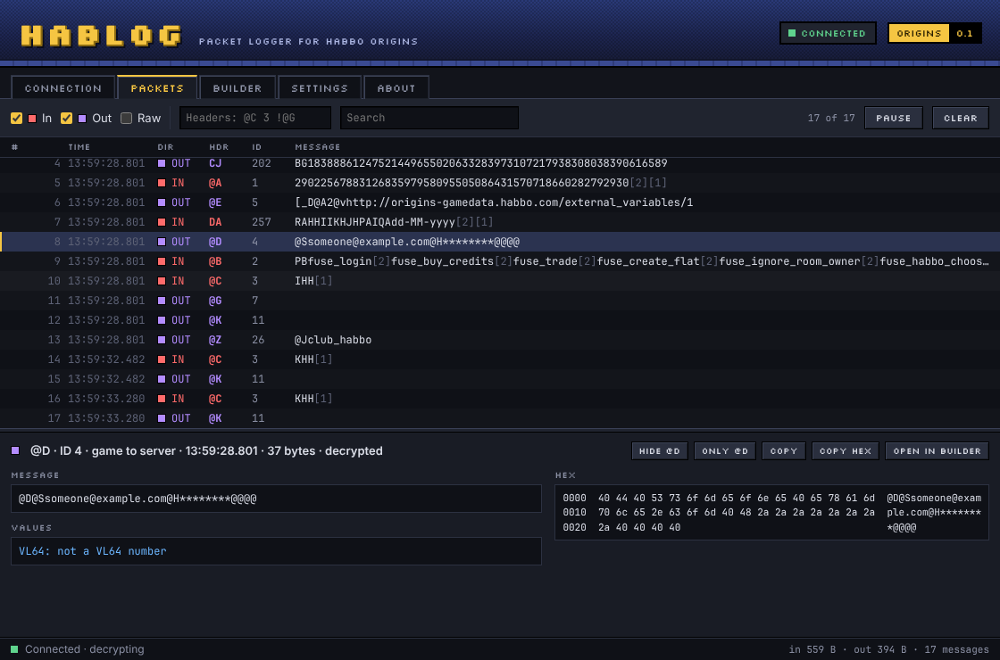

# Hablog
Hablog relays Habbo Origins through your computer and logs its traffic. It's a TCP proxy written in Rust on the Tokio runtime.
This was kinda just an excuse to learn more Rust, but it'd be pretty easy to use as a starting point for packet tooling.

## Running

```bash
cargo run --release
```

That's it. Hablog:

1. Finds the Origins client the Habbo Launcher installed, and reads the game server from the client itself.
2. Starts the relay on `127.0.0.1` and writes `Hablog-Routed.exe` next to the client: a copy that connects to the relay instead. The installed client, the launcher and the hosts file are never changed.
3. Starts the game. When the observer is set up it starts it through Frida so you also see the decrypted traffic; the first time, Hablog offers to set it up for you.
4. Prints the traffic and saves each session to `logs/`.
5. Stops when you close the game, or when you press Ctrl+C.

Close Origins first if it's already open; that copy is connected directly.

### WSL
Under WSL, Hablog runs as a Linux program but still does all of the above. Through WSL's interop it finds Windows' AppData folder, starts the Windows game, and runs the observer with Windows' Node.js. The game reaches the relay through WSL's localhost forwarding, which is on by default. For decrypted traffic, keep the project on a Windows drive (such as `/mnt/c/...`) and install Node.js on Windows. Running Hablog directly on Windows (`cargo run` in PowerShell) works too.

On macOS and other Linux systems Hablog prepares everything and tells you which file to start on Windows.

## The window
Hablog also has a window, made with [Tauri](https://tauri.app). It does the same as the command line and shares its `hablog.toml`, `logs/` and `automation/`:

* **Connection**: start and stop, what was found, traffic counters, the observer (with a button to set it up), and what Hablog is doing.
* **Packets**: the log, one row per message with its header and ID. Filter by direction, by header (`@C 3` shows only those, `!@G` hides one) or by text, pause it, and select a message to see it in full, its values decoded and a hex dump. Raw traffic is a toggle.
* **Builder**: `hablog build` and `hablog decode` as a form, with a live preview. Double-click a message in the log to open it here.
* **Settings**: `hablog.toml` as a form. Saving keeps the file's comments.



It needs [Node.js](https://nodejs.org) and [Tauri's prerequisites](https://tauri.app/start/prerequisites/) (on Windows, that's the WebView2 runtime, which Windows 10 and 11 already have). Then:

```bash
cd gui
npm install
npm run tauri dev
```

`npm run tauri build` builds `target/release/hablog-gui`; run it from inside the repository so it finds `automation/`. `npm run dev` alone shows the window in a browser at http://localhost:1420 with a made-up session, for working on the window without the game.

## Settings
The first run creates `hablog.toml` next to where you run Hablog, with every setting explained. The defaults are the automatic behavior above, so you only need it to change something:

| Setting | Default | |
|---|---|---|
| `hotel` | `"auto"` | The hotel the launcher last opened, or `"hhous"`, `"hhobr"`, `"hhoes"`. |
| `launch` | `true` | Start the game automatically. |
| `decrypt` | `true` | Show decrypted traffic through the observer when it's available. |
| `show` | `"both"` | Which traffic to print: `"both"`, `"in"`, `"out"` or `"none"`. |
| `show_raw` | `false` | Also print the raw TCP chunks and frame headers. |
| `save_captures` | `true` | Save each session to its own file. |
| `captures_folder` | `"logs"` | Where those files go. |

`[advanced]` has settings you normally don't need: a different game server, AppData folders elsewhere (such as a Wine prefix), and the observer's folder. A typo in the file is reported instead of being ignored.

## Reading the log
Each game message is one line: direction, its two-character header, the header's numeric ID, then the body. Bytes that can't be printed show as `[n]`: `[2]` ends a string and `[1]` ends a server message. Header and body together are exactly what was sent:

```
18:15:02.114  IN  @B    2  PBfuse_login[2]fuse_buy_credits[2]fuse_trade[2][1]
18:15:02.120 OUT  @Z   26  @Jclub_habbo
```

Client and server use separate header sets, so `IN @D` and `OUT @D` are unrelated messages. Numbers in a body are written in VL64 (server bodies mostly: `PB` above is 8) or as B64 lengths (client strings: `@J` is 10, then the 10 characters `club_habbo`); `hablog decode` reads and writes both. Booleans are VL64 too (`H` false, `I` true), so the bytes alone can't tell `I` = 1 from `I` = true. Some Shockwave messages also separate fields with `[9]` (tab) or `[13]` (line break), or send a value as plain text with no end at all.

Every session starts with `IN @@ 0 [1]`: HELLO, after which the game starts sending.

The first messages of a session, the key exchange, travel unencrypted and always show this way. Everything after that is encrypted, and needs the observer to be read.

`show_raw = true` in `hablog.toml` adds the raw traffic underneath, dimmed: each TCP chunk as it was sent (`wire`), the small frame header before each decrypted message (`frame`), and the connections the game opens. Without decrypted traffic, the encrypted chunks are printed anyway, since they are all there is to show. The capture files always hold every chunk.

## Decrypted traffic
The observer in [automation/](automation/README.md) starts the game through Frida and reads the game's own encrypt/decrypt calls, so the encrypted messages can be shown too.

It needs [Node.js](https://nodejs.org) 22 or later. When it isn't installed yet, Hablog asks whether to run `npm ci` in `automation/` for you. It only supports the BobbaXtra build it was written for (client 371 still ships it) and refuses any other without touching the game, in which case the game starts normally.

Decrypted messages are only printed, never saved. The password in the login message is shown as `*`s so a log can be shared, but everything else you send, such as your email address and chat, is shown as is.

## Other commands

```bash
cargo run --release -- details
```

Shows what Hablog found: the launcher, the installed version, and for each hotel the game and MUS servers built into its client, its site and external variables URLs, and any client that is already running.

```bash
cargo run --release -- decode PB
```

Reads VL64 and B64 values, and writes numbers as them. Paste part of a body from the log, `[n]` included, and it shows the numbers it starts with and any B64-length string:

```
$ hablog decode "RAHHIIKHJHPAIQAdd-MM-yyyy[2][1]"
VL64: RA = 6, H = 0, H = 0, I = 1, I = 1, K = 3, H = 0, J = 2, H = 0, PA = 4, I = 1, QA = 5, then dd-MM-yyyy[2][1]
B64:  not a B64 number or string
$ hablog decode 206
VL64: Rs
B64:  CN (a header or string length), @CN (a client message length)
```

Without a value it keeps asking for more.

```bash
cargo run --release -- build @C b:true i:0 s:hello
```

The reverse of `decode`: builds the exact message from its header and typed values, in the notation the log uses:

```
$ hablog build DA i:6 i:0 i:0 i:1 i:1 i:3 i:0 i:2 i:0 i:4 i:1 i:5 s:dd-MM-yyyy
DARAHHIIKHJHPAIQAdd-MM-yyyy[2][1]
hex: 44415241484849494b484a48504149514164642d4d4d2d797979790201
```

The header is written as in the log (`DA`) or as its ID (`257`). Values are `i:` numbers, `b:` true/false, `s:` strings and `r:` raw text, with `[n]` for any byte. Messages are built as the server sends them to the game (strings end with `[2]`, the message with `[1]`); start with `out` for a message the game sends, where strings carry their length instead. Hablog can't send messages yet; see [docs/tasks/sending-messages.md](docs/tasks/sending-messages.md).

```bash
cargo run --release -- decrypt
```

Decrypts captured messages by hand with your own session's shared key (56 bytes as 112 hex characters, from the client's `Crypto_GetSharedKeyHex`). It reads the key from `session.secret` if that file exists, otherwise it asks, then asks for each message's details and remembers your last answers. Files ending in `.secret` are ignored by git. The cipher has no authentication tag, so a wrong key or counter still gives output; it just isn't readable.

## Captures
Each session is saved to its own file, for example `logs/hablog-20261030-181502-1.jsonl`, and existing files are never overwritten. The first line is a header, then one line per TCP chunk with its exact bytes as hex:

```json
{"format":"hablog-capture","version":1,"record_kind":"tcp_chunk","client":"127.0.0.1:52144","upstream":"1.2.3.4:40001","started_ms":1793358835100}
{"index":1,"timestamp_ms":1793358835100,"direction":"client_to_server","bytes":"51454273623264706267"}
```

A row is a TCP read, not necessarily one complete message.

## How the relay handles connections
* One game connection is relayed at a time. Another one is closed while it's active, and a new one is accepted after it disconnects, so you can relog without restarting Hablog.
* Each direction is copied by its own loop in a single task, with Nagle's algorithm off for low latency. When one side closes, its last bytes are forwarded before the close is passed on.
* The game server's DNS name is looked up for each connection, connecting times out after 5 seconds per address, and errors are reported without stopping the relay.
* Logging never slows the game down. Traffic is handed to the log through a bounded queue; if the log falls behind, chunks are left out of it (and counted) rather than delaying forwarding. The log handles the queue in batches with one console write and one capture write each, since the Windows console is slow per write.
* The relay only listens on loopback, and refuses a game server that resolves to the relay itself.

## Project Structure
* `main.rs`: The commands and the console.
* `session.rs`: A session from start to finish (discovery, the relay, the observer, starting the game, captures), told to the console or the window as a stream of events.
* `tools.rs`: `hablog details`, `decode` and `build`.
* `settings.rs`: `hablog.toml`, its documented template, and saving it with its comments kept.
* `proxy.rs`: The relay.
* `capture.rs`: Writes the JSONL capture files.
* `logger.rs`: Console output.
* `model.rs`: Traffic direction and capture records.
* `wsl.rs`: Finding Windows folders, converting paths and starting Windows programs from WSL.
* `origins/discovery.rs`: Finds the launcher, installed versions, each hotel's client and the servers built into it, and running clients.
* `origins/routing.rs`: Writes the routed copy of the client.
* `origins/observer.rs`: Runs the observer in `automation/` and reads its events.
* `origins/crypto.rs`: The session decoder used by `hablog decrypt`.
* `origins/fuse.rs`: Splits traffic into FUSE messages, reads and writes VL64 and B64, and masks the login password.
* `gui/`: The window. `src-tauri/` is its Rust side, a thin layer of commands over the library; `src/` is the page, plain TypeScript built with Vite.

## Tests

```bash
cargo test
```

```bash
cd automation && npm test
```

```bash
cd gui && npm run build
```

The Rust tests cover the relay over loopback (exact forwarding both ways, half-closes, reconnects, a second connection, shutdown, the self-connection check and a full log queue), discovery and routing against fixture installations, the settings template, the crypto test vectors, and the observer protocol against a stand-in companion (skipped without Node.js). The observer's own tests run its agent against simulated memory. `npm run build` in `gui/` type-checks the window.

# Demos of the original Habbo version

https://github.com/Libaration/Hablog/assets/11550216/e01ad50f-07e5-4dbf-842e-d4c14cbec4cc

https://github.com/Libaration/Hablog/assets/11550216/8865c60e-22a4-442c-9528-f77280a6472a
